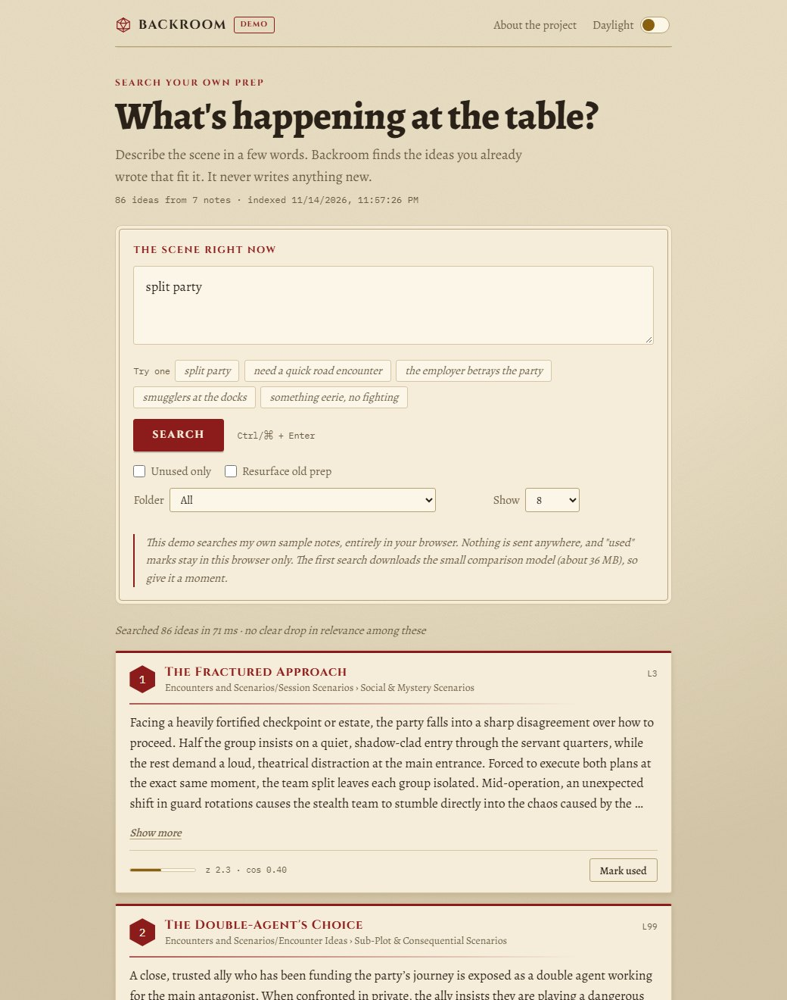

# Backroom

[](https://github.com/dstew2816/backroom/actions/workflows/tests.yml)

**A search box for your own Dungeon Master ideas.** You jot ideas down however they come, with no format to follow, and Backroom keeps every one of them findable. When players do something you did not plan for, or you just need filler, you type a few words about what is happening, like "split party" or "stuck on a road at night", and it shows the ideas you already wrote that fit, best match first. It finds them by meaning, so you do not have to remember the words you used. It remembers which ideas you have already run, so you are not served the same one twice. It never writes anything for you and never sends your notes anywhere.

**[Try the live demo](https://dstew2816.github.io/backroom/?q=split+party)**. It runs entirely in your browser, on 86 ideas from my own sample notes.

[](https://dstew2816.github.io/backroom/?q=split+party)

## How it works

1. **Read.** It reads a folder of Markdown notes. The notes are never changed.
2. **Cut into ideas.** Each paragraph or top-level bullet becomes one idea, labelled with the headings above it. Notes pasted without any Markdown marks are read the same way.
3. **Fingerprint.** A small model on your own computer (all-MiniLM-L6-v2, about 25 MB) turns each idea into 384 numbers that stand for what it is about. Ideas about similar things get similar numbers.
4. **Search.** What you type is fingerprinted the same way and compared with every idea. The closest ones come back first.
5. **Remember.** Ideas you mark as used are stored apart from your notes, so you can hide them or bring back ones you have not touched in a while.

## Decisions I made, and why

- **It finds, it never writes.** There is no text generation and no call to any AI service. Every result is something I wrote. A game master's prep is personal, and a tool that invents content would be a different tool.
- **Everything stays on the computer.** The only network access is a one-time download of the search model. The index and the "used" marks live in git-ignored folders.
- **Notes as they are written.** The splitter handles headings, bold labels, bullets, and plain pasted text with numbered titles. Real notes are messy, so the tests use messy input.
- **Only changed notes are reprocessed.** Unchanged files are skipped by size and date, then by content. An edited note reuses the fingerprints of the ideas in it that did not change.
- **"Used" marks survive editing.** An idea is identified by its own text, not its line number, so adding notes above it does not lose the mark.
- **Honest about weak matches.** Each result shows how far it stands above a typical idea, and the page draws a line where relevance drops sharply.
- **Measured, not guessed.** An evaluation harness compares seven designs (idea size, heading context, keyword matching, and a mix) by how often the right idea lands near the top. On 67 test questions over the demo notes, the current design puts a right idea in the top 5 for 87% of them, and no alternative clearly beats it. See [Evaluation](#evaluation) for the table and its limits.
- **The demo is the real code.** The static demo runs the same search code in the browser against a prebuilt index, with no server behind it.

Built with TypeScript on Node, [transformers.js](https://github.com/huggingface/transformers.js) for the model, and Vitest. The web page is a single HTML file with no framework. The tests use a stand-in for the model, so they run in seconds without downloading anything.

## Setup

Needs Node 20 or newer.

```
npm install
npm start -- "C:\path\to\your\notes"
```

Then open http://127.0.0.1:5127. After the first run the folder is remembered, so `npm start` is enough.

The first run downloads a small embedding model (about 25 MB, one time). That is the only network access. Everything after runs locally.

Your notes are only read. The index, the usage state and the logs are written to `data/` and `logs/` in this project, and both are git-ignored.

## Using the web page

- Type the current situation, press Search (or Ctrl+Enter).
- Each result is one idea (a paragraph or a top-level bullet) with its note, heading and line numbers.
- **Mark used** records it in `data/state.json`. **Unused only** hides those.
- **Resurface old prep** gives ideas you've never used, or haven't used in a long time, a small boost.
- **Re-index** picks up notes you added or edited. Only changed files are processed.

## Command line

```
npm run index -- "<notes folder>"        build or refresh the index
npm run search -- "<scene>"              options: -n 8, --unused, --tag x, --folder "sub/folder", --stale, --reindex
npm run used -- 2                        mark result #2 of the last search as used (add --undo)
npm run chunks -- "<notes folder>"       show how the notes are split into ideas (add --all)
npm run timings                          summarise logs/timings.jsonl
npm run eval -- --notes <folder> --scenes <file>   compare design choices (see Evaluation)
npm test
```

## Static demo (GitHub Pages)

The demo ships a precomputed index and runs the search in the visitor's browser. It makes no outside requests; the model and runtime files are served from the same site.

1. Put the notes you are happy to make public in `demo-sample/`. Every word of that folder becomes public text in the built site.
2. `npm run build:demo -- demo-sample` (writes `docs/`)
3. `npm run preview:demo` to check it locally at http://127.0.0.1:5128
4. Commit `docs/` and `demo-sample/`, then in the repository settings set Pages to deploy from the `main` branch, `/docs` folder.

First visit downloads about 36 MB (model and runtime); the browser caches it afterwards. "Used" marks in the demo are stored in the visitor's browser only.

The build refuses folders outside `demo-sample/` unless you pass `--allow-outside`.

## Evaluation

The question it answers: when I type a scene, how often does the right idea show up near the top of the results? That lets design choices (idea size, heading context, keyword matching) be compared with numbers instead of by feel. It only finds and ranks text you wrote; it never writes text.

### Results so far

Measured on the public demo notes (86 ideas) with 67 test questions. **The questions were drafted with an AI assistant, in the short, loose style I search in, not written by hand by me.** They are in [`eval/demo-scenes.json`](eval/demo-scenes.json), so the table can be reproduced with `npm run eval -- --notes demo-sample --scenes eval/demo-scenes.json`.

| Design | Right idea in top 5 | In top 10 | Mean reciprocal rank | Never found |
|---|---|---|---|---|
| **Current: ideas up to 900 characters, labels on, meaning search** | **87%** | **94%** | **0.759** | 0 of 67 |
| Ideas up to 300 characters | 72% | 84% | 0.563 | 0 of 67 |
| Ideas up to 600 characters | 85% | 94% | 0.747 | 0 of 67 |
| Ideas up to 1500 characters | 87% | 94% | 0.759 | 0 of 67 |
| Labels off (no heading context) | 88% | 91% | 0.763 | 0 of 67 |
| Keywords only (BM25) | 73% | 79% | 0.642 | 12 of 67 |
| Meaning plus keywords (hybrid) | 81% | 90% | 0.763 | 0 of 67 |

What I take from it:

- **The current design stays.** One question is worth 1.5 points, so the designs within a few points of it are tied, and none is clearly better.
- **Meaning search earns its place.** Keyword matching never found the idea for 12 of the 67 questions, because the question shared no word with the note.
- **Searching by kind of situation is the weak spot.** The 59 questions about a specific moment ("fake tax collectors") reached the top 5 for 90%. The 8 about a kind of situation ("random encounter", "side quest hook") reached it for 63%. Eight is too few to be sure, but it is where the next work goes.
- **Labels help exactly there.** For those 8, mean reciprocal rank was 0.67 with labels and 0.50 without; for specific moments, labels made no real difference.

Limits, stated plainly:

- The questions came from an assistant that had read the notes, so they are probably easier than what I would type cold. Read the numbers as optimistic.
- 86 ideas is a small haystack. A few thousand real notes would be harder.
- The drop for 300-character ideas is partly the test's own doing: an idea cut into pieces is only credited through its first piece.
- Nothing here was measured on my private notes.


```
npm run eval -- --notes "<notes folder>" --scenes <scenes.json>
```

Optional: `--work <folder>` (where the per-design indexes go; default `eval/.work/<scenes file name>`), `--external "Smart Connections=<file.json>"` (repeatable), `--verbose` (list scenes where the baseline missed the top 10), `--json <file>` (also write the numbers to a file). The first run downloads the search model if it is not already cached, and builds one index per design, so it takes a while.

### What is measured

For each scene, the harness finds the position ("rank") of the first result that contains the expected idea. Then:

- **Recall at 5**: the share of scenes where the right idea is in the top 5 results.
- **Recall at 10**: the share of scenes where the right idea is in the top 10 results.
- **Mean reciprocal rank** (MRR): for each scene take 1 divided by the rank (1 for first place, 0.5 for second, 0.33 for third, and 0 if the idea is not found at all), then average over all scenes. It rewards putting the right idea higher up. 1.0 is perfect.
- **Not found**: scenes where the idea appeared nowhere in the ranking.

Worked example: five scenes with ranks 1, 3, 7, 12 and not found give recall at 5 = 2/5, recall at 10 = 3/5, and MRR = (1 + 1/3 + 1/7 + 1/12 + 0) / 5.

The harness calls the app's real search code, so it measures what the app actually does.

### Scene file format

JSON. Either an object, or a bare list of scenes:

```json
{
  "label": "My scenes",
  "publishable": false,
  "scenes": [
    { "scene": "The party arrives at a harbor town at night", "file": "places/harbor.md", "expect": "the harbor master takes bribes" },
    { "scene": "A chase across rooftops", "expect": ["rooftop chase", "slate tiles are slick"] }
  ]
}
```

- `scene` (required): the text you would search with.
- `expect` (required): a short, distinctive snippet of the idea that should come back, or a list of snippets (any one counts).
- `file` (optional): the note's path relative to the notes folder. Narrows the match to that note.
- `label` (optional): a name printed above the results.
- `publishable` (optional): `false` prints a "do not publish" banner. Use it for synthetic or private sets.

### How the expected idea is identified

By a snippet of its text, checked with "contains" against each result's text after markdown marks (bold, links and so on) are stripped, ignoring capitals and extra spaces. Ideas have no titles, an idea's ID includes a hash of its text so it changes whenever the idea size changes, and line numbers shift when notes are edited. A text snippet stays the same across all the design variants.

Caveat: if a small idea size cuts your snippet in half, the idea counts as "not found". Keep snippets short (6 to 10 words) and near the start of the idea.

### Comparing other tools (for example Smart Connections)

Run the other tool on the same scenes yourself and save its results as JSON, best result first:

```json
[
  { "scene": "The party arrives at a harbor town at night", "results": ["text of result 1", "Harbor Notes", "text of result 3"] }
]
```

Each result is either the result's text or just the note's name. The `scene` text must match the scenes file exactly. A result counts as correct if it contains the expected snippet, or if it is exactly the expected note's name (when `file` is given). Pass it with `--external "Smart Connections=results.json"`.

### One index folder per design

An index records which design choices built it, and a different choice means the old index is not reused. The harness therefore keeps a separate index folder for each design under the `--work` folder. If you build indexes yourself, never point two designs at the same folder. `eval/dev/` and `eval/.work/` are git-ignored.

### Designs compared

1. Baseline: ideas up to 900 characters, note title and headings added before searching, meaning-based search (embeddings).
2. Ideas up to 300 characters.
3. Ideas up to 600 characters.
4. Ideas up to 1500 characters.
5. No heading context (the idea's own text only).
6. Keywords only, using BM25 (a standard word-matching score where rare words count for more).
7. Hybrid: meaning and keyword rankings combined with reciprocal rank fusion (each ranking gives an idea 1 / (60 + its position) points and the points are added).

## Notes on how it works

- Notes are split on headings, paragraphs and top-level bullets. A bullet's indented children stay with it. One-line bullets are kept. Paragraphs over about 900 characters are split at sentence boundaries.
- Notes pasted without Markdown marks are read the same way as marked ones: a short numbered line directly above its text (`1. The Title`) is that idea's title, and a short plain line directly above such an entry is its section. A note that opens with a `---` divider is not mistaken for a settings block.
- Each idea is embedded with its note title and heading trail for context (all-MiniLM-L6-v2, 8-bit quantised, via transformers.js).
- A scene is embedded when you search, so new text never needs indexing to be used as a query. New notes do need a re-index before they can be found.
- Scores are cosine similarity. The page also shows `z`, how far above the average idea in your notes the match scores, and draws a divider where relevance drops sharply.
- Usage state is keyed on the idea's text, not its line number, so marks survive edits above it. Rewriting the idea itself counts as a new idea.

## License

The code is under the [MIT license](LICENSE). The notes in `demo-sample/`, and the text built from them in `docs/data/`, are my own writing and are not covered by it.
